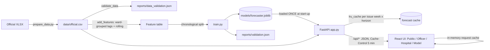

# Architecture — Dengue Early Warning (EDU AI Engineering Hackathon 2026, Phase 1)

Ward-level dengue forecasts for **2, 3 and 4 weeks ahead** from the official dataset
(31,320 weekly rows · 60 wards · 5 cities · 2016-01-04 → 2025-12-29). Bangla-first React UI, FastAPI, pandas, scikit-learn.

## Data flow



```
Browser ──► React (Vite build, static) ──► /api/... ──► FastAPI ──► cached forecasts ──► joblib model (in RAM)
```

## Weather lag pipeline (`backend/common.py`)
Computed per `ward_id` (`groupby` + `shift`/`rolling`, so no value ever crosses a ward boundary):
`rainfall_mm` at lags 0–4 weeks, 4-week and 8-week rainfall sums; `avg_temp_c` and `relative_humidity_pct` (current + 4-week mean);
recent cases (lags 0–3, 4-week mean); ward vulnerability (`population_density_sqkm`, `water_logging_risk_index`, `sanitation_score`); week-of-year sin/cos.
Targets are `dengue_cases` shifted by −2, −3, −4 weeks. Rationale: rain → standing water → 7–14 day mosquito development → incubation → cases, i.e. a 2–4 week lag.

## Chronological validation split (no leakage)
| Set | Rule (per horizon h) | Use |
|---|---|---|
| Train | target week ≤ 2022-12-31 | fit candidates; derive tier cut-offs |
| Validation | issue week in 2023, target ≤ 2023-12-31 | pick model, fit uncertainty bands, group importance |
| Test | issue week ≥ 2024-01-01 with an observed target | reported once, after refit on train+validation |

Splits use **both issue and target dates**, so a training target can never fall inside validation. Tests prove (a) lags match manual ward slices,
(b) scrambling every observation after week *t* leaves all features at ≤ *t* unchanged, (c) split masks never overlap.

## Model selection rationale
Candidates per horizon: Ridge (scaled linear) vs `HistGradientBoostingRegressor(loss="poisson")`. Cases are non-negative counts with spikes
in monsoon, so a Poisson-loss boosted tree captures non-linear rain-lag/season interactions and respects counts; it won validation MAE for all
three horizons. Ridge is kept as the transparent comparator.
Baselines on the test set: **last observed week** and **ward training mean**.

| Horizon | Test MAE | Test RMSE | Last-week baseline MAE / RMSE | Ward-mean baseline MAE |
|---|---|---|---|---|
| 2 wk | 1.037 | 2.089 | 1.691 / 3.328 | 3.098 |
| 3 wk | 1.065 | 2.104 | 1.924 / 3.632 | 3.105 |
| 4 wk | 1.279 | 2.542 | 2.136 / 3.924 | 3.113 |

(cases per ward per week, 2024–2025 held-out; regenerate with `python train.py`.) These are measured on this dataset only; provenance of the data is unspecified.

## Risk tiers (Low / Medium / High / Critical)
Cut-offs are **training-period percentiles (p50, p80, p95) of weekly ward cases = [0, 5, 13]**: Low ≤ 0, Medium 1–5, High 6–13, Critical ≥ 14.
Observed counts are integers, so a continuous estimate is compared at the half-integer boundaries (0.5, 5.5, 13.5) — a continuity correction.
Tests assert that for every integer *k* the estimate-tier equals the observed-count-tier, so no estimate is moved by ad-hoc rounding.
Tiers are *relative case burden*, not per-capita rates (no reliable ward populations in the data). City totals use city-level percentiles of weekly city sums.
Test-period tier agreement: 73–79 % exact (see Model Performance view). An 80 % band comes from validation residual quantiles per tier (test coverage 79–85 %).

## Compute and API cost controls
* **No external APIs, no LLM calls, no paid services** — zero token/API cost; all inference is local.
* Model and data are loaded **once** at start-up (`joblib`, compressed); features are built once in memory.
* `lru_cache` on (issue week, horizon) → one vectorised `predict` for all 60 wards, reused by the grid, Top-10, ward detail and city totals (a test asserts 1 miss / ≥2 hits).
* Deterministic GET responses carry `Cache-Control: public, max-age=300`; the UI also de-duplicates identical requests in memory.
* Static React build is served by the same FastAPI process: one command, one port, local dataset and saved model.

## Honesty constraints
Forecasts are **retrospective replays** on data ending 2025-12-29, never live 2026 surveillance (banner + per-forecast label).
Each forecast states whether the week was inside the training period (demonstration only) or in the held-out test period.
No map polygons or coordinates exist in the dataset, so the risk view is an accessible ward grid. No patient records, admissions or bed predictions.

The final eligible test issue weeks were 2025-12-15, 2025-12-08 and 2025-12-01 for the 2-, 3- and 4-week horizons respectively. Each has a recorded target by 2025-12-29. Reported metrics come from the team ML handoff (backend/reports/validation.json); the saved model in that handoff and this repository have identical SHA-256 hashes.

Startup checks the CSV fingerprint against the saved model. A missing input, mismatched CSV or absent validation report prevents startup. Use the matching private inputs described in the README. The application serves bundled assets locally after the frontend has been built.


## Round 2 additions

`backend/operations.py` (pure, deterministic engine: demand, allocation, crews, overflow, simulation) → `backend/phase2.py` (`/api/plan`, `/api/simulate`, `/api/dispatch`, `/api/brief`, `/api/export`) and `backend/community.py` (`/api/geo/districts`, `/api/facilities`, `/api/reports` on stdlib SQLite). One plan computation feeds the screen, SMS, brief and CSV, so they always agree. Frontend adds `ops.jsx`, `MapHub.jsx` (wraps the team's `WardMap.jsx`), `Report.jsx` and `round2.css`. The Phase 1 model, split and tiers are unchanged (retrain reproduced a byte-identical model). Details: [docs/ROUND2.md](docs/ROUND2.md).

